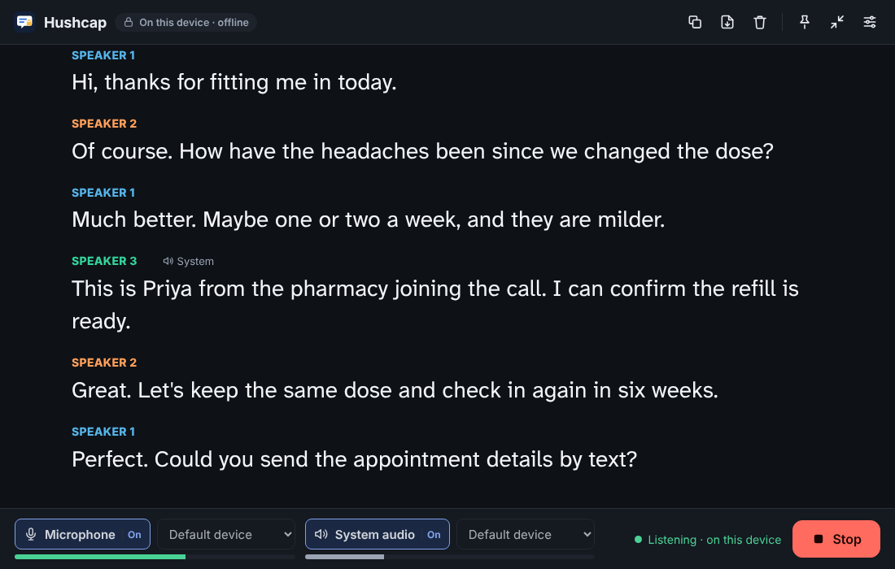
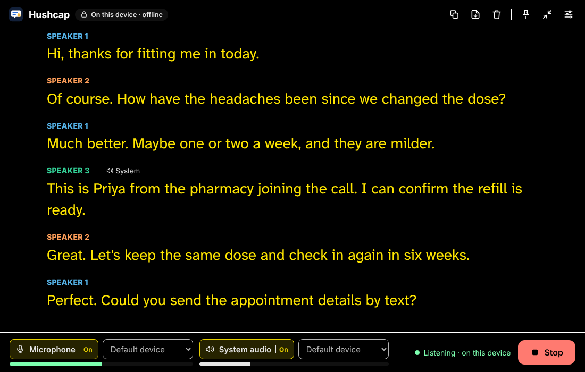
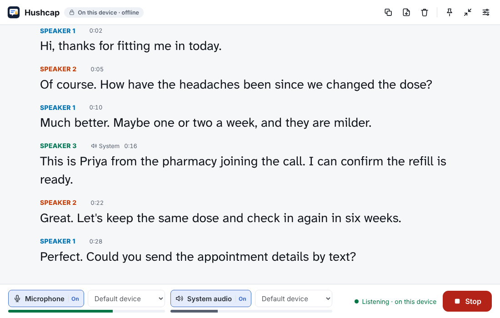
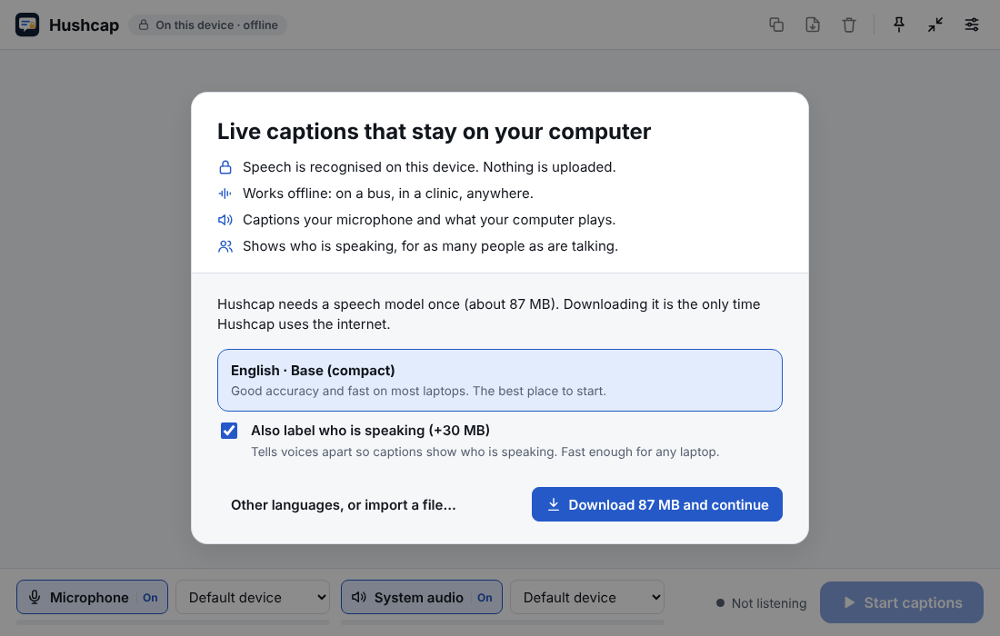
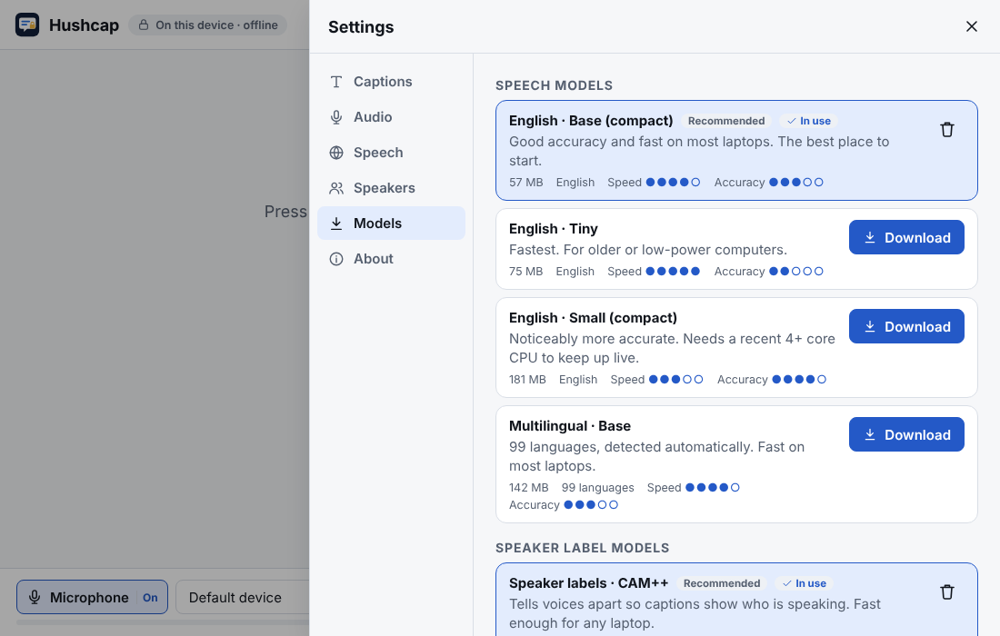

<p align="center">
  
</p>

<h1 align="center">Hushcap</h1>

<p align="center">
  <strong>Private, offline live captions for Windows, Linux and Android.</strong><br />
  Captions your microphone <em>and</em> your device's audio, shows who is speaking, and never sends a
  second of sound anywhere.
</p>

<p align="center">
  <a href="https://github.com/lobojoel2003/Hushcap/actions/workflows/ci.yml"></a>
  <a href="https://github.com/lobojoel2003/Hushcap/releases/latest"></a>
  <a href="LICENSE"></a>
</p>

---

<p align="center">
  
</p>

## Why Hushcap exists

Deaf and hard-of-hearing people need captions in the places where privacy matters most: doctor
visits, therapy, family dinners, job interviews and work meetings. Sending that audio to a cloud
service is a privacy problem, and in a bus, a basement clinic or a rural area with no signal, cloud
captions simply stop working.

The WHO estimates that over 430 million people live with disabling hearing loss. The closest
existing tool, [ClearCaps](https://dev.to/galtranch/live-captions-without-sending-your-voice-to-the-cloud-building-clearcaps-13k7),
proved that on-device captions work, but it is iPhone-only (iOS 26+), closed source, charges
$2.99 a month for extras, and its speaker labels break down above about four people.

Hushcap fills that gap:

|                        | Hushcap                                   | Cloud captions          | ClearCaps                |
| ---------------------- | ----------------------------------------- | ----------------------- | ------------------------ |
| Where speech is processed | On your device                         | Remote servers          | On device                |
| Works with no internet | ✅ after a one-time model download         | ❌                      | ✅                        |
| Platforms              | Windows, Linux, Android (+ CLI)           | Varies                  | iPhone (iOS 26+)         |
| Microphone captions    | ✅                                         | ✅                      | ✅                        |
| Device / system audio  | ✅ calls, videos, podcasts                 | Varies                  | —                        |
| Speaker labels         | ✅ no fixed limit on speakers              | Varies                  | Unreliable above ~4      |
| Price                  | Free                                      | Subscription / ads      | $2.99/month for extras   |
| Source code            | Open (GPL-3.0-or-later)                   | Closed                  | Closed                   |

## Features

- **Live captions on the device.** Desktop uses [whisper.cpp](https://github.com/ggml-org/whisper.cpp);
  Android uses [Vosk](https://alphacephei.com/vosk/), which streams in real time on phone CPUs.
- **Microphone and system audio, together.** Caption the room, a video call, a film, or both at
  once. When a call plays through speakers, the microphone's echo of it is suppressed so lines aren't doubled.
- **Who said what.** A neural speaker-embedding model (ONNX, run by the pure-Rust
  [tract](https://github.com/sonos/tract) engine) tells voices apart. Profiles improve as people talk
  and are merged if one person is split in two. Click a label to rename it ("Dr. Rivera", "Grandma").
- **Words as they are spoken.** Provisional text appears in grey while someone talks and is
  replaced by the final caption when they pause.
- **Built for reading.** Large type by default, Atkinson Hyperlegible or OpenDyslexic fonts, line
  spacing control, light/dark/**yellow-on-black high-contrast** themes, colour-blind-safe speaker
  colours, a captions-only view and an always-on-top window to float over calls.
- **Save or share transcripts** as plain text, SRT, WebVTT, Markdown or JSON, only when you choose to.
- **99 languages** with multilingual Whisper models, optional translation into English, and
  15 languages (16 Vosk models) on Android.
- **Command-line tool** for live captions in a terminal and batch transcription of recordings.

## Screenshots

| High contrast | Light, with timestamps |
| --- | --- |
|  |  |
| **First run** | **Models** |
|  |  |

<sub>Screenshots use the desktop app's built-in demo conversation (run the UI in a browser with
`npm run dev`); no real conversation was recorded.</sub>

## Privacy

Hushcap is private by design, not by policy:

- Audio is captured, recognised and labelled **in the Hushcap process on your device**. It is never
  uploaded, and it is never written to disk.
- **Transcripts live in memory** until you save, share or clear them, or close the app.
- **No accounts, analytics, telemetry, ads, crash reporting or update checks.**
- The **only** network request Hushcap makes is downloading a model you picked, over HTTPS, from an
  allow-listed host (Hugging Face and GitHub on desktop, alphacephei.com on Android). Downloads are
  checked against a SHA-256 checksum and the model format before they are used. You can also copy
  model files over by hand and never connect at all.
- The desktop app's web view has **no network access** (strict Content Security Policy); Android
  disables cloud backup and device transfer of app data.

Read the full [privacy statement](PRIVACY.md).

## Download

Get the latest version from the **[Releases page](https://github.com/lobojoel2003/Hushcap/releases/latest)**.

| Platform | File | Notes |
| --- | --- | --- |
| Windows 10/11 (64-bit) | `Hushcap_<version>_x64-setup.exe` or `Hushcap_<version>_x64_en-US.msi` | Installs per-user (EXE) or system-wide (MSI). |
| Debian, Ubuntu, Mint | `Hushcap_<version>_amd64.deb` | `sudo apt install ./Hushcap_<version>_amd64.deb` |
| Fedora, openSUSE | `Hushcap-<version>-1.x86_64.rpm` | `sudo dnf install ./Hushcap-<version>-1.x86_64.rpm` |
| Any Linux | `Hushcap_<version>_amd64.AppImage` | `chmod +x` and run. |
| Android 8.0+ | `Hushcap_<version>_android.apk` | Allow "install unknown apps" for your browser or file manager. Device audio needs Android 10+. |
| Command line | `hushcap-cli-<version>-<os>-x86_64` archives | Linux and Windows. |

Every release includes `SHA256SUMS.txt`. Verify a download with `sha256sum -c SHA256SUMS.txt
--ignore-missing`.

> **CPU requirements (desktop):** release builds target x86-64 CPUs with AVX2 (most PCs from
> 2013 onwards). Older CPUs are too slow for live Whisper captions; build from source for them.
>
> **Windows SmartScreen** may warn that the installer is unrecognised because it is not code-signed.
> Choose *More info → Run anyway*.

## Getting started

### Desktop (Windows and Linux)

1. Install and open Hushcap.
2. The welcome screen offers the recommended English model (57 MB) and the speaker-label model
   (30 MB). Click **Download and continue**. This is the only time Hushcap needs the internet.
3. Choose **Microphone**, **System audio**, or both, at the bottom of the window.
4. Press **Start captions** (or <kbd>Ctrl</kbd>+<kbd>Enter</kbd>).

Tips:

- For a video call, turn on **System audio** to caption the other people and **Microphone** to
  caption yourself. With speakers instead of headphones, keep *Ignore the microphone while system
  audio is talking* on.
- <kbd>Ctrl</kbd>+<kbd>T</kbd> keeps the window on top; <kbd>Ctrl</kbd>+<kbd>M</kbd> shows captions only.
- If captions fall behind, pick a faster model (Settings → Models) or the *Fast* setting (Settings → Speech).

### Android

1. Install the APK and open Hushcap.
2. Tap **Download English model and speaker labels** (about 53 MB), or pick another language under
   **Settings → Speech models**.
3. Choose **Microphone** and/or **Device audio**, then tap **Start**. Android asks for microphone
   permission, and for device audio it asks to "start recording or casting". That prompt is how
   Android 10+ lets an app hear other apps' audio. Hushcap records nothing to storage.
4. Captions keep running with the screen off. The latest line appears in the notification, but never
   on the lock screen.

Android limitations: apps can opt out of audio capture, and Android never lets third-party apps
capture phone-call audio. Many video and meeting apps can be captioned; some can't.

## Models

Models are downloaded once and then used offline. You can switch at any time.

**Desktop speech models** (whisper.cpp GGML format, from
[ggerganov/whisper.cpp on Hugging Face](https://huggingface.co/ggerganov/whisper.cpp)):

| Model | Size | Languages | Use it when |
| --- | ---: | --- | --- |
| English · Base (compact) — *recommended* | 57 MB | English | Good accuracy, fast on most laptops |
| English · Tiny | 75 MB | English | Older or low-power computers |
| English · Base | 142 MB | English | Slightly more accurate than compact |
| English · Small (compact) | 181 MB | English | Better accuracy; needs a recent 4+ core CPU |
| English · Small | 466 MB | English | Best English accuracy for live use on a fast CPU |
| Multilingual · Tiny / Base / Small | 75–466 MB | 99 languages | Speech in other languages, or translation |
| Multilingual · Large v3 Turbo (compact) | 547 MB | 99 languages | Powerful desktops; may lag live speech |

**Speaker-label models** (ONNX, from the
[sherpa-onnx model releases](https://github.com/k2-fsa/sherpa-onnx/releases/tag/speaker-recongition-models)):
CAM++ (30 MB, recommended, fast) and WeSpeaker ResNet34 (26 MB, most accurate, more CPU).

**Android models** come from [Vosk](https://alphacephei.com/vosk/models): small models for 15
languages (31–133 MB) plus the 13 MB speaker model.

**Offline installation:** on another computer, download a `.bin` (speech) or `.onnx` (speaker) file
for desktop, or a Vosk `.zip` for Android. Copy it over and use **Import a model file**.

## How it works

```text
microphone ─┐                                              ┌─► captions (UI / terminal)
            ├─► resample to 16 kHz ─► voice activity ─► utterances ─► whisper.cpp ─┤
system audio┘     (per source)          detection       + interim     (speech→text) ├─► transcript export
                                                         snapshots                   │
                                       speaker embedding (ONNX, in parallel) ─► online clustering ─► "who"
```

- **Capture:** [cpal](https://github.com/RustAudio/cpal). Windows uses WASAPI loopback on the output
  device; Linux uses the "monitor" source of a PulseAudio/PipeWire sink (pure-Rust client, no
  `libpulse` needed). Silence is filled in when loopback pauses, so all sources share one timeline.
- **Segmentation:** an adaptive, band-limited energy detector learns the background noise floor
  (quiet office, café, bus) and cuts speech into utterances. Long monologues are split at the quietest
  recent moment.
- **Recognition:** Whisper runs on finished utterances (with a shortened encoder window for short
  phrases) and on periodic snapshots for interim text. Final phrases are never dropped; interim ones
  are skipped if the CPU is busy, so captions never fall behind. Known Whisper hallucinations on
  silence ("Thanks for watching!") and repetition loops are filtered out.
- **Speakers:** Kaldi-compatible filterbank features (verified to match the reference
  implementation) feed the embedding model; embeddings are clustered online with cosine similarity.

More detail: [docs/ARCHITECTURE.md](docs/ARCHITECTURE.md).

## Command-line tool

```bash
hushcap models download recommended      # speech + speaker models (the only network use)
hushcap devices                          # list microphones and system audio sources
hushcap live --mic --system              # live captions in the terminal; Enter to stop
hushcap live --system -o meeting.srt     # caption a call and save subtitles
hushcap transcribe interview.wav -f vtt -o interview.vtt
hushcap models                           # list, verify, import or delete models
```

`hushcap --help` lists every option. The CLI and the desktop app share the same model folder.

## Building from source

Prerequisites: [Rust](https://rustup.rs) (the pinned toolchain installs automatically),
[Node.js 22+](https://nodejs.org), CMake and a C/C++ compiler (for whisper.cpp), and Clang/libclang.

**Linux (Debian/Ubuntu):**

```bash
sudo apt install build-essential cmake clang libasound2-dev libwebkit2gtk-4.1-dev \
  libgtk-3-dev libayatana-appindicator3-dev librsvg2-dev libxdo-dev libssl-dev
```

**Windows:** Visual Studio 2022 Build Tools (Desktop C++), CMake and LLVM.

Then:

```bash
git clone https://github.com/lobojoel2003/Hushcap && cd Hushcap

# Desktop app
cd desktop && npm ci && npm run tauri dev      # development
npm run tauri build                            # installers in target/release/bundle/

# CLI
cargo build --release -p hushcap-cli           # target/release/hushcap

# Android (JDK 17 + Android SDK)
cd android && ./gradlew assembleDebug          # app/build/outputs/apk/debug/
```

For portable desktop binaries, build with `GGML_NATIVE=OFF` (an AVX2 baseline instead of
optimising for your own CPU).

### Tests and checks

```bash
cargo fmt --all -- --check && cargo clippy --workspace --all-targets -- -D warnings
cargo test --workspace
cd desktop && npm run lint && npm run check && npm test
cd android && ./gradlew lintDebug testDebugUnitTest
```

## Project layout

```text
crates/hushcap-core     DSP, voice detection, segmentation, fbank features, speaker clustering,
                        transcript formats, model catalogue (pure Rust, no I/O)
crates/hushcap-engine   audio capture, whisper.cpp, ONNX speaker embeddings, live pipeline,
                        model downloads and storage
crates/hushcap-cli      the `hushcap` command-line tool
desktop/                Tauri 2 app: Svelte 5 UI (src/) and Rust shell (src-tauri/)
android/                Kotlin + Jetpack Compose app with Vosk
scripts/                version tooling
docs/                   architecture and release notes for maintainers
```

## Versioning and releases

Hushcap follows [Semantic Versioning](https://semver.org). The single source of truth is the
[`VERSION`](VERSION) file; `scripts/bump-version.sh` updates every manifest and
`scripts/check-version.sh` (run in CI) makes sure they agree.

- **Tags** are `vMAJOR.MINOR.PATCH`. Pushing a tag builds and publishes a GitHub Release.
- **Build numbers** are the CI run number, embedded in every binary along with the git commit and
  build date (see *About*, `hushcap --version`, or the Android About screen).
- **Android `versionCode`** is derived from the version: `MAJOR×10000 + MINOR×100 + PATCH`.
- Changes are recorded in [CHANGELOG.md](CHANGELOG.md).

Maintainers: see [docs/RELEASING.md](docs/RELEASING.md).

## Continuous integration and delivery

- **CI** (every push and pull request): version consistency; `rustfmt`, `clippy -D warnings` and
  tests on Linux and Windows; an end-to-end test that downloads a real Whisper model and transcribes
  a known recording; the speaker model integration test; frontend lint, type-check, unit tests and
  build; Android lint, unit tests and APK build.
- **Release** (on `v*` tags): builds Windows (MSI, NSIS), Linux (deb, rpm, AppImage), Android (APK)
  and CLI archives, writes `SHA256SUMS.txt` and publishes the GitHub Release with notes from the
  changelog.
- **Model catalogue check** (monthly and on demand): downloads every catalogue model and verifies its
  checksum, so broken or changed upstream files are caught early.
- **Dependabot** keeps Cargo, npm, Gradle and GitHub Actions dependencies current.

## Roadmap

- macOS build (microphone first; system audio via ScreenCaptureKit)
- GPU acceleration (Vulkan/CUDA) for larger models
- Whisper on Android for higher accuracy on recent phones
- Saved sessions with optional on-device encryption
- More interface languages

Ideas and help are welcome. See [CONTRIBUTING.md](CONTRIBUTING.md).

## Contributing, security and conduct

- [Contributing guide](CONTRIBUTING.md)
- [Security policy](SECURITY.md): please report vulnerabilities privately.
- [Code of conduct](CODE_OF_CONDUCT.md)

## Acknowledgements

Hushcap stands on excellent open-source work: [whisper.cpp](https://github.com/ggml-org/whisper.cpp)
and OpenAI Whisper, [Vosk](https://github.com/alphacep/vosk-api) and Kaldi,
[sherpa-onnx](https://github.com/k2-fsa/sherpa-onnx) (model exports), [WeSpeaker](https://github.com/wenet-e2e/wespeaker)
and [3D-Speaker](https://github.com/modelscope/3D-Speaker) (speaker models),
[tract](https://github.com/sonos/tract), [cpal](https://github.com/RustAudio/cpal),
[Tauri](https://tauri.app), [Svelte](https://svelte.dev), the
[Atkinson Hyperlegible](https://www.brailleinstitute.org/freefont/) font by the Braille Institute,
and [OpenDyslexic](https://opendyslexic.org). Thanks to the author of ClearCaps for showing what
private captions can do.

## License

Hushcap is free software: you can redistribute it and/or modify it under the terms of the
[GNU General Public License](LICENSE), version 3 or (at your option) any later version. Models you
download are distributed by their authors under their own licenses (Whisper: MIT; Vosk models:
Apache 2.0; speaker models: see their model cards).
